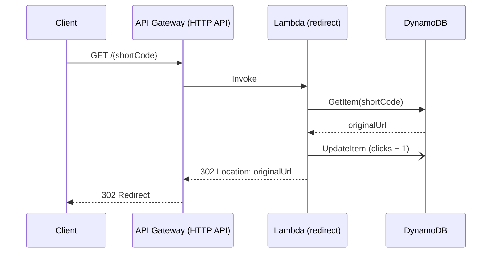
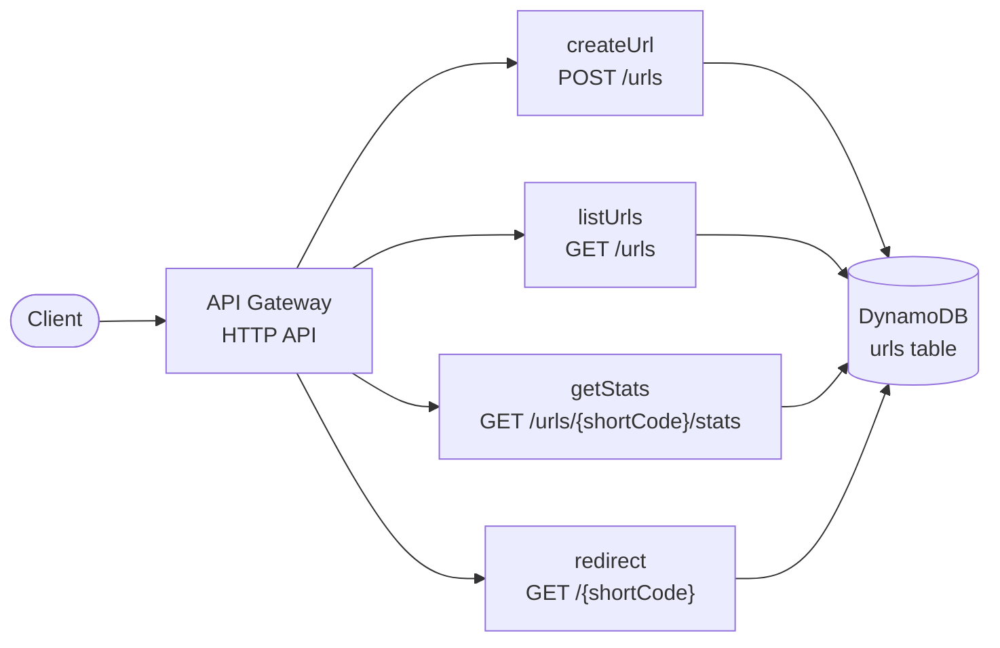

<div align="center">
  <h1>Zipwyn Serverless</h1>
  <p>The serverless backend behind <a href="https://zipwyn.navindalc.app">Zipwyn</a> - an AWS Lambda + API Gateway + DynamoDB URL shortener with click tracking, defined as code with the Serverless Framework.</p>

<p align="center">
  
  
  
  
  
  
</p>

[Live Redirects](https://short.navindalc.app) • [Zipwyn Web App](https://zipwyn.navindalc.app) • [Report Bug](https://github.com/paradocx96/zipwyn-serverless/issues)
</div>

---

## Overview

Zipwyn Serverless is the public-facing, high-traffic half of the Zipwyn platform. It resolves short codes to their
destination URLs, counts clicks, and exposes a small HTTP API for creating and inspecting links.

Everything runs on managed AWS services with **no servers to patch and no idle cost**: requests hit an API Gateway HTTP
API, which invokes Node.js 20 Lambda functions that read and write a DynamoDB table billed per request. The whole
stack - functions, routes, IAM role, and table - is declared in a single `serverless.yml` and deployed to isolated
stages (`dev`, `prod`).

> The authenticated dashboard, OAuth, and link management UI live in the main Zipwyn Next.js app. See
> the [Zipwyn monorepo](https://github.com/paradocx96/zipwyn).

## Highlights

- **Infrastructure as Code** - API routes, Lambda functions, IAM permissions and the DynamoDB table are all defined in
  `serverless.yml` and provisioned through CloudFormation
- **Multi-stage deployments** - `--stage` flag drives per-stage resource names and base URLs (`dev` on the default API
  Gateway URL, `prod` on the custom domain `short.navindalc.app`)
- **Pay-per-use cost model** - HTTP API + Lambda + DynamoDB `PAY_PER_REQUEST`; scales to zero when idle and needs no
  capacity planning
- **Scoped IAM** - the Lambda role is limited to specific DynamoDB actions on this stack's table and its indexes only
- **Safe writes** - conditional puts (`attribute_not_exists`) prevent short-code collisions and silent overwrites under
  concurrency
- **Cursor-based pagination** - list endpoint returns an opaque `nextCursor` built from DynamoDB's `LastEvaluatedKey`
- **Redirects that always count** - `302` responses are sent with `Cache-Control: no-cache, no-store, must-revalidate`,
  so browsers and proxies never skip the function
- **Local development** - `serverless-offline` serves the API on `http://localhost:3001`

---

## Architecture





### Data model

Single DynamoDB table, `PAY_PER_REQUEST`, named `url-shortener-urls-<stage>` by the Serverless stack.

| Attribute     | Type   | Notes                                                                    |
|---------------|--------|--------------------------------------------------------------------------|
| `shortCode`   | String | **Partition key**                                                        |
| `originalUrl` | String | Destination of the redirect                                              |
| `createdAt`   | Number | Epoch milliseconds                                                       |
| `clicks`      | Number | Incremented atomically on each redirect (`if_not_exists(clicks, 0) + 1`) |

---

## API Reference

All responses are JSON unless noted. Replace `$BASE_URL` with your stage's URL (for example
`https://short.navindalc.app`).

| Method | Path                      | Description                                    |
|--------|---------------------------|------------------------------------------------|
| `POST` | `/urls`                   | Create a short link (random or custom code)    |
| `GET`  | `/urls`                   | List links (paginated)                         |
| `GET`  | `/urls/{shortCode}/stats` | Get destination, click count and creation time |
| `GET`  | `/{shortCode}`            | `302` redirect to the destination              |

### `POST /urls`

```bash
curl -X POST "$BASE_URL/urls" \
  -H "Content-Type: application/json" \
  -d '{"url": "https://example.com/a/very/long/path", "customCode": "docs"}'
```

`customCode` is optional. If omitted, a 7-character [nanoid](https://github.com/ai/nanoid) is generated (64-character
URL-safe alphabet, ~4.4 trillion combinations).

**`201 Created`**

```json
{
  "shortCode": "docs",
  "shortUrl": "https://short.navindalc.app/docs",
  "originalUrl": "https://example.com/a/very/long/path",
  "createdAt": 1760000000000
}
```

| Status | Meaning                                                  |
|--------|----------------------------------------------------------|
| `400`  | `url` missing or not a valid URL                         |
| `409`  | Custom code already exists, or a code collision occurred |
| `500`  | Unexpected error                                         |

### `GET /urls?limit=50&cursor=<token>`

Returns up to `limit` links (default `50`). When more results exist the response includes `nextCursor`; pass it back as
`cursor` to fetch the next page.

```json
{
  "urls": [
    {
      "shortCode": "docs",
      "shortUrl": "https://short.navindalc.app/docs",
      "originalUrl": "https://example.com/a/very/long/path",
      "clicks": 12,
      "createdAt": 1760000000000
    }
  ],
  "nextCursor": "eyJzaG9ydENvZGUiOiJkb2NzIn0="
}
```

### `GET /urls/{shortCode}/stats`

```json
{
  "shortCode": "docs",
  "originalUrl": "https://example.com/a/very/long/path",
  "clicks": 12,
  "createdAt": 1760000000000
}
```

Returns `404` if the code does not exist.

### `GET /{shortCode}`

Returns `302 Found` with a `Location` header pointing at the destination, or a `404` HTML page if the code is unknown.
Requests for `favicon.ico` and `robots.txt` return `404` without touching the database.

> `urls` is effectively a reserved word: the static `/urls` route takes precedence over `/{shortCode}`.

---

## Project Structure

```
zipwyn-serverless/
├── src/
│   ├── handlers/                 # Serverless Framework handlers (bundled with dependencies)
│   │   ├── createUrl.js          # POST /urls
│   │   ├── listUrls.js           # GET  /urls
│   │   ├── getStats.js           # GET  /urls/{shortCode}/stats
│   │   └── redirect.js           # GET  /{shortCode}
│   ├── utils/
│   │   ├── dynamodb.js           # Shared DynamoDB Document client + table name
│   │   └── shortcode.js          # nanoid-based short code generator
│   └── lambda/                   # Dependency-free .mjs variants for manual/console deployment
│       ├── createUrl.mjs
│       ├── listUrls.mjs
│       ├── getStats.mjs
│       └── redirect.mjs
├── serverless.yml                # Functions, routes, IAM role, DynamoDB table, outputs
├── package.json
├── pnpm-lock.yaml
└── .env-example
```

### Two ways to ship the same functions

| Location        | Use it when…                                                           | Notes                                                                                             |
|-----------------|------------------------------------------------------------------------|---------------------------------------------------------------------------------------------------|
| `src/handlers/` | Deploying with the Serverless Framework (the primary, repeatable path) | Uses `nanoid`, reads table and base URL from environment variables                                |
| `src/lambda/`   | Pasting a function straight into the Lambda console or a zip upload    | No third-party packages (inline code generator); table name is hard-coded to `url-shortener-urls` |

---

## Getting Started

### Prerequisites

- **Node.js** 20 or later
- **pnpm** (or npm/yarn)
- An **AWS account** and credentials with permission to create CloudFormation stacks, Lambda functions, API Gateway
  APIs, IAM roles and DynamoDB tables
- The **Serverless Framework v4** (installed as a dev dependency; requires a free `serverless login` or a
  `SERVERLESS_ACCESS_KEY`)

### Install

```bash
git clone https://github.com/paradocx96/zipwyn-serverless.git
cd zipwyn-serverless
pnpm install
```

### Configure AWS credentials

```bash
aws configure --profile zipwyn      # or: aws sso login --profile zipwyn
export AWS_PROFILE=zipwyn
npx serverless login
```

### Run locally

```bash
pnpm dev        # serverless offline → http://localhost:3001
```

`serverless-offline` emulates API Gateway and Lambda only. The handlers still talk to a real DynamoDB table in your
configured AWS account/region (or a local DynamoDB endpoint of your choosing), so deploy the `dev` stage once first.

### Deploy

```bash
pnpm run deploy            # stage: dev  → default API Gateway URL
pnpm run deploy:prod       # stage: prod → https://short.navindalc.app (custom domain)
```

> Use `pnpm run <script>` for `deploy` and `remove`: pnpm has built-in commands with those names that would otherwise
> take precedence over the package scripts.

On success the stack prints an `ApiUrl` output. Smoke-test it:

```bash
curl -X POST "$API_URL/urls" -H "Content-Type: application/json" -d '{"url":"https://example.com"}'
curl -i "$API_URL/<shortCode>"      # expect: HTTP/2 302 + Location header
```

### Tear down

```bash
pnpm run remove                         # removes the dev stage
npx serverless remove --stage prod      # removes the prod stage
```

---

## Configuration

Settings live in `serverless.yml` and are injected into the functions as environment variables.

| Setting / variable | Where                    | Description                                       |
|--------------------|--------------------------|---------------------------------------------------|
| `provider.region`  | `serverless.yml`         | AWS region (default `ap-southeast-1`)             |
| `provider.stage`   | `--stage` flag           | Deployment stage, default `dev`                   |
| `URLS_TABLE`       | `provider.environment`   | DynamoDB table name, `url-shortener-urls-<stage>` |
| `BASE_URL`         | `custom.baseUrl.<stage>` | Public origin used to build `shortUrl` values     |

`.env-example` documents the variable names and example values for reference.

---

## Security & Operations Notes

- **Least privilege** - the function role may only call `GetItem`, `PutItem`, `UpdateItem`, `Query` and `Scan` on this
  stack's table and its indexes
- **No secrets in code** - AWS credentials come from the deploy environment; `.env` is git-ignored
- **Concurrency-safe creates** - `ConditionExpression: attribute_not_exists(shortCode)` guards every insert
- **Error hygiene** - internal errors are logged to CloudWatch Logs and returned to clients as a generic `500`
- **Observability** - each function logs to its own CloudWatch log group out of the box

## Known Limitations & Roadmap

This service is built to be small and cheap; the items below are deliberate next steps rather than hidden surprises.

- [ ] **Auth on management routes** - `POST /urls` and `GET /urls` are currently unauthenticated with open CORS. In the
  Zipwyn platform, link management goes through the authenticated web app; the next step is to restrict this service to
  redirects (or add a JWT/IAM authorizer)
- [ ] **Stricter input validation** - creation only checks that the input parses as a URL. The web app enforces an
  `http(s)` allowlist, private-host blocking and custom-code format rules; port these here
- [ ] **Await the click counter** - the redirect handler updates `clicks` without awaiting the write; awaiting it (or
  moving to an async queue/stream) guarantees counts are not lost when the execution environment freezes
- [ ] **Listing via indexed query** - `GET /urls` uses a table `Scan`; replace with a per-user GSI query
- [ ] **Per-function IAM roles** - `redirect` only needs `GetItem`/`UpdateItem`
- [ ] **CI/CD** - GitHub Actions pipeline deploying `dev` on pull requests and `prod` on release, authenticating with
  AWS via OIDC (no long-lived keys)
- [ ] **Monitoring** - CloudWatch alarms (5xx rate, throttles, latency) and dashboards; optional X-Ray tracing
- [ ] **Edge protection** - AWS WAF / throttling on the HTTP API stage
- [ ] **Tests** - unit tests for handlers and integration tests against DynamoDB Local

---

## Related

- **[Zipwyn (monorepo)](https://github.com/paradocx96/zipwyn)** - web app + this serverless service in one workspace
- **[Zipwyn web app](https://github.com/paradocx96/zipwyn-app)** - Next.js dashboard, authentication and analytics UI

## Author

**Navinda Chandrasiri** - [@paradocx96](https://github.com/paradocx96)

## License

Copyright © 2026 Navinda Chandrasiri. All rights reserved.
