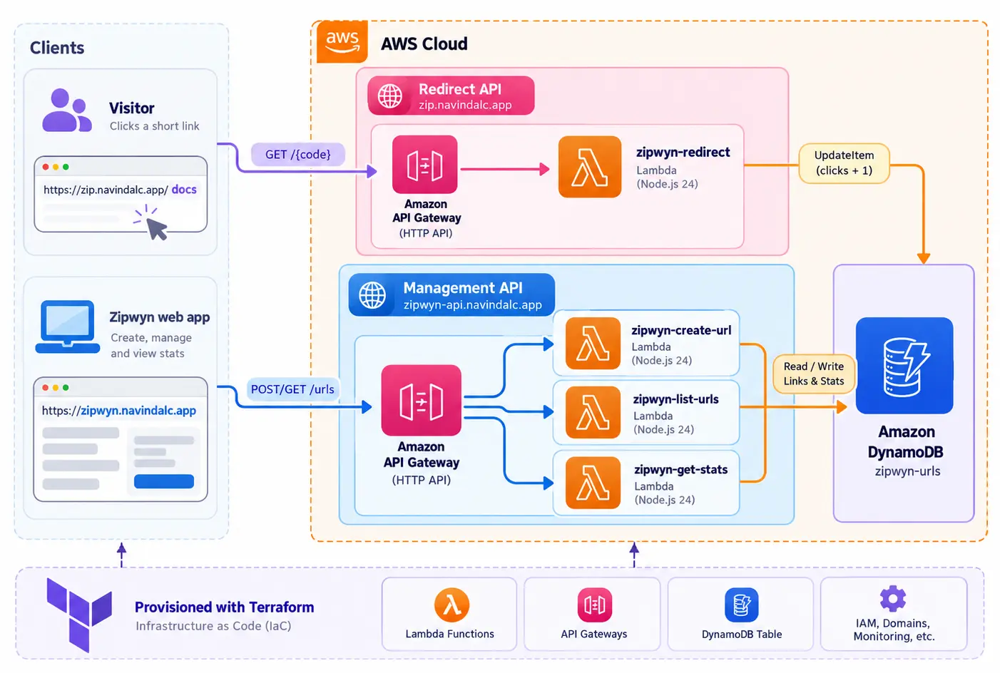

<div align="center">
  <h1>Zipwyn Serverless</h1>
  <p>The serverless backend of <a href="https://zipwyn.navindalc.app">Zipwyn</a>: short links, redirects and click tracking on AWS Lambda, API Gateway and DynamoDB, provisioned with Terraform.</p>

  <p>
    
    
    
    
    
    
  </p>

<a href="#getting-started">Getting started</a> ·
<a href="#api-reference">API reference</a> ·
<a href="https://github.com/paradocx96/zipwyn-serverless/issues">Report a bug</a>
</div>

---

## Table of contents

- [Overview](#overview)
- [Features](#features)
- [Architecture](#architecture)
- [Project structure](#project-structure)
- [Getting started](#getting-started)
- [Configuration](#configuration)
- [API reference](#api-reference)
- [Infrastructure](#infrastructure)
- [Deployment](#deployment)
- [Security](#security)
- [Operations](#operations)
- [Roadmap](#roadmap)
- [Related projects](#related-projects)
- [Author](#author)
- [License](#license)

## Overview

Zipwyn Serverless is the public-facing, high-traffic half of the Zipwyn platform. It resolves short codes to their
destinations, counts every click, and exposes a small HTTP API for creating and inspecting links.

It runs entirely on managed AWS services, so there are no servers to patch and no idle cost: requests reach an API
Gateway HTTP API, which invokes Node.js Lambda functions that read and write a DynamoDB table billed per request. All
infrastructure is declared in Terraform.

> The authenticated dashboard and link-management UI live in the Zipwyn web app (Next.js). This repository contains
> only the backend.

## Features

- **Two isolated APIs**: a public redirect API and a separate management API, each with its own domain, throttling and
  access logs
- **Atomic click counting**: a redirect is a single conditional `UpdateItem` that increments the counter and returns
  the destination, so clicks are never lost and unknown codes never create stray records
- **Safe link creation**: only `http(s)` destinations, no embedded credentials, no links back to Zipwyn itself,
  conditional writes to prevent collisions, and automatic retry on random-code collisions
- **Cursor-based pagination** for listing links
- **Least-privilege IAM**: one role per function, each limited to the DynamoDB actions it needs
- **Optional API key** for the management API (`x-api-key`)
- **Infrastructure as Code**: Terraform with remote state, per-function log groups, CloudWatch alarms and a reusable
  API module
- **Runs locally**: the same Lambda handlers behind a local API Gateway emulator and DynamoDB Local, no AWS account
  needed
- **Cheap to run**: HTTP API + Lambda (arm64) + on-demand DynamoDB scale to zero when idle

## Architecture

<p>
  
</p>

[//]: # (```mermaid)
[//]: # (flowchart LR)
[//]: # (  visitor&#40;[Visitor]&#41; -->|" GET /{code} "| redirectApi["Redirect API<br/>zip.navindalc.app"])
[//]: # (  webapp&#40;[Zipwyn web app<br/>zipwyn.navindalc.app]&#41; -->|" POST/GET /urls "| mgmtApi["Management API<br/>zipwyn-api.navindalc.app"])
[//]: # (  redirectApi --> fnRedirect["zipwyn-redirect"])
[//]: # (  mgmtApi --> fnCreate["zipwyn-create-url"])
[//]: # (  mgmtApi --> fnList["zipwyn-list-urls"])
[//]: # (  mgmtApi --> fnStats["zipwyn-get-stats"])
[//]: # (  fnRedirect --> ddb[&#40;"DynamoDB<br/>zipwyn-urls"&#41;])
[//]: # (  fnCreate --> ddb)
[//]: # (  fnList --> ddb)
[//]: # (  fnStats --> ddb)
[//]: # (```)

[//]: # (```mermaid)
[//]: # (sequenceDiagram)
[//]: # (  participant V as Visitor)
[//]: # (  participant G as API Gateway &#40;redirect API&#41;)
[//]: # (  participant L as Lambda &#40;zipwyn-redirect&#41;)
[//]: # (  participant D as DynamoDB &#40;zipwyn-urls&#41;)
[//]: # (  V ->> G: GET /{shortCode})
[//]: # (  G ->> L: Invoke)
[//]: # (  L ->> D: UpdateItem &#40;clicks + 1, return destination&#41;)
[//]: # (  D -->> L: originalUrl)
[//]: # (  L -->> G: 302 Location: originalUrl)
[//]: # (  G -->> V: 302 Redirect)
[//]: # (```)

### Hostnames

| Hostname                   | Purpose                             | Served by                  |
|----------------------------|-------------------------------------|----------------------------|
| `zip.navindalc.app`        | Public short links (`/{shortCode}`) | Redirect API (this repo)   |
| `zipwyn-api.navindalc.app` | Management API used by the web app  | Management API (this repo) |
| `zipwyn.navindalc.app`     | Zipwyn web app                      | Hosted separately          |

DNS for `navindalc.app` is managed at Name.com; the records you need are listed by Terraform.

### Data model

One DynamoDB table, `zipwyn-urls`, on-demand billing, point-in-time recovery enabled.

| Attribute     | Type   | Notes                                    |
|---------------|--------|------------------------------------------|
| `shortCode`   | String | **Partition key**                        |
| `originalUrl` | String | Destination of the redirect              |
| `createdAt`   | Number | Epoch milliseconds                       |
| `clicks`      | Number | Incremented atomically on every redirect |

## Project structure

```
zipwyn-serverless/
├── src/
│   ├── lambda/                  # Lambda handlers (deployed to AWS)
│   │   ├── createUrl.mjs        # POST /urls
│   │   ├── listUrls.mjs         # GET  /urls
│   │   ├── getStats.mjs         # GET  /urls/{shortCode}/stats
│   │   └── redirect.mjs         # GET  /{shortCode}
│   └── lib/                     # Shared code: config, DynamoDB client, validation, HTTP helpers
├── scripts/
│   └── dev-server.mjs           # Local API Gateway emulator for development
├── test/                        # Unit tests (node:test, no AWS needed)
├── infra/terraform/             # Infrastructure as code
│   ├── modules/http-api/        #   Reusable HTTP API + custom domain module
│   └── *.tf                     #   DynamoDB, Lambda, IAM, ACM, APIs, alarms, outputs
├── docker-compose.yml           # DynamoDB Local for development
├── .github/workflows/ci.yml     # Tests + Terraform fmt/validate
└── README.md
```

The AWS SDK v3 is provided by the Lambda runtime, so the deployed package contains only `src/` (about 17 KB, no
`node_modules`). The SDK packages in `devDependencies` exist solely for local development and tests.

## Getting started

### Prerequisites

| Tool                                                   | Version                 | Needed for                     |
|--------------------------------------------------------|-------------------------|--------------------------------|
| [Node.js](https://nodejs.org)                          | 20.12+ (24 recommended) | Local API, tests               |
| [pnpm](https://pnpm.io)                                | 10+                     | Installing dependencies        |
| [Docker](https://www.docker.com)                       | any recent              | DynamoDB Local                 |
| [Terraform](https://developer.hashicorp.com/terraform) | 1.10+                   | Deploying (not needed locally) |

### Run it locally

```bash
git clone https://github.com/paradocx96/zipwyn-serverless.git
cd zipwyn-serverless
pnpm install

cp .env.example .env        # optional: the defaults already work
pnpm run db:start           # DynamoDB Local on http://localhost:8000
pnpm run dev                # Zipwyn API on http://localhost:3001
```

The dev server runs the real Lambda handlers, creates the `zipwyn-urls` table automatically, and emulates API Gateway
including CORS. Production splits the routes across two domains; locally everything is served from
`http://localhost:3001`.

Try it:

```bash
curl -X POST http://localhost:3001/urls \
  -H "Content-Type: application/json" \
  -d '{"url": "https://example.com/a/very/long/path", "customCode": "docs"}'

curl -i http://localhost:3001/docs               # 302 + Location header
curl http://localhost:3001/urls/docs/stats       # click count
curl http://localhost:3001/urls                  # list links
```

### Use it with the Zipwyn frontend

1. Start the backend as above (`http://localhost:3001`).
2. Point the frontend's API base URL at `http://localhost:3001`.
3. Run the frontend on `http://localhost:3000` (or `127.0.0.1:3000`), which is allowed by CORS by default. For another
   origin, set `CORS_ALLOWED_ORIGINS` in `.env` (comma-separated, or `*`) and restart.

Short links returned by the local API look like `http://localhost:3001/<code>` and work in the browser straight away.

### Scripts

| Command                | Description                                                  |
|------------------------|--------------------------------------------------------------|
| `pnpm run dev`         | Start the local API on port 3001                             |
| `pnpm run dev:watch`   | Same, restarting on file changes                             |
| `pnpm run db:start`    | Start DynamoDB Local (Docker)                                |
| `pnpm run db:stop`     | Stop DynamoDB Local                                          |
| `pnpm test`            | Run the unit tests                                           |
| `pnpm run tf:fmt`      | Format the Terraform code                                    |
| `pnpm run tf:validate` | Initialise (without backend) and validate the Terraform code |

Local data is kept in a Docker volume. Reset it with
`pnpm run db:stop && docker volume rm zipwyn-serverless_zipwyn-dynamodb-data`.

## Configuration

### Lambda / local environment variables

| Variable               | Required | Description                                                                     |
|------------------------|----------|---------------------------------------------------------------------------------|
| `URLS_TABLE`           | yes      | DynamoDB table name (`zipwyn-urls`)                                             |
| `BASE_URL`             | yes¹     | Public origin used to build `shortUrl` values, e.g. `https://zip.navindalc.app` |
| `MANAGEMENT_API_KEY`   | no       | When set, create/list/stats requests must send it as the `x-api-key` header     |
| `DYNAMODB_ENDPOINT`    | local    | DynamoDB Local endpoint (`http://localhost:8000`). Leave unset in AWS           |
| `PORT`                 | local    | Local API port (default `3001`)                                                 |
| `CORS_ALLOWED_ORIGINS` | local    | Origins the local API accepts (production CORS is configured in Terraform)      |

¹ Falls back to the request's domain name if unset. In AWS, Terraform sets it for you.

See [`.env.example`](.env.example). In AWS these are injected by Terraform; never commit a real `.env`.

### Terraform variables

The most useful ones; the full list with descriptions is in
[`infra/terraform/variables.tf`](infra/terraform/variables.tf) and an annotated example in
[`terraform.tfvars.example`](infra/terraform/terraform.tfvars.example).

| Variable                    | Default          | Description                                          |
|-----------------------------|------------------|------------------------------------------------------|
| `aws_region`                | `ap-southeast-1` | Region for everything, including the ACM certificate |
| `root_domain`               | `navindalc.app`  | Domain whose DNS lives at Name.com                   |
| `redirect_subdomain`        | `zip`            | Public short-link host                               |
| `api_subdomain`             | `zipwyn-api`     | Management API host                                  |
| `frontend_subdomain`        | `zipwyn`         | Web app host (used for the default CORS allow-list)  |
| `redirect_extra_domains`    | `[]`             | Extra hosts for short links, e.g. a legacy domain    |
| `enable_custom_domains`     | `false`          | Turn on after the ACM certificate is validated       |
| `dynamodb_table_name`       | `zipwyn-urls`    | DynamoDB table name                                  |
| `management_api_key`        | `""`             | Optional shared secret for the management API        |
| `alarm_email`               | `""`             | Enables CloudWatch alarms and email notifications    |
| `disable_default_endpoints` | `false`          | Make the custom domains the only way in              |

## API reference

All responses are JSON unless noted. `$BASE` is the redirect domain for `GET /{shortCode}` and the management API
domain for everything else (both `http://localhost:3001` when running locally).

If a `management_api_key` is configured, send it with every management request:

```
x-api-key: <your key>
```

| Method | Path                      | API        | Description                                 |
|--------|---------------------------|------------|---------------------------------------------|
| `POST` | `/urls`                   | Management | Create a short link (random or custom code) |
| `GET`  | `/urls`                   | Management | List links (paginated)                      |
| `GET`  | `/urls/{shortCode}/stats` | Management | Destination, click count and creation time  |
| `GET`  | `/{shortCode}`            | Redirect   | `302` redirect to the destination           |

### `POST /urls`

```bash
curl -X POST "$BASE/urls" \
  -H "Content-Type: application/json" \
  -d '{"url": "https://example.com/a/very/long/path", "customCode": "docs"}'
```

| Field        | Required | Rules                                                                                                          |
|--------------|----------|----------------------------------------------------------------------------------------------------------------|
| `url`        | yes      | Absolute `http` or `https` URL, up to 2048 characters, no embedded credentials, not a Zipwyn link              |
| `customCode` | no       | 3 to 32 characters: letters, numbers, `-`, `_`. Reserved words (`api`, `urls`, `health`, `admin`) are rejected |

Without `customCode`, a random 7-character code is generated (62 characters, about 3.5 trillion combinations).

**`201 Created`**

```json
{
  "shortCode": "docs",
  "shortUrl": "https://zip.navindalc.app/docs",
  "originalUrl": "https://example.com/a/very/long/path",
  "createdAt": 1760000000000
}
```

| Status | Meaning                                                           |
|--------|-------------------------------------------------------------------|
| `400`  | Invalid body, URL, or custom code (the `error` field says which)  |
| `401`  | Missing or wrong `x-api-key` (only when an API key is configured) |
| `409`  | Custom code already exists                                        |
| `503`  | Could not generate a unique random code; retry                    |
| `500`  | Unexpected error                                                  |

### `GET /urls?limit=50&cursor=<token>`

Returns up to `limit` links (1 to 100, default 50). When more results exist the response includes `nextCursor`; pass
it back as `cursor` for the next page. Invalid `limit` or `cursor` values return `400`.

```json
{
  "urls": [
    {
      "shortCode": "docs",
      "shortUrl": "https://zip.navindalc.app/docs",
      "originalUrl": "https://example.com/a/very/long/path",
      "clicks": 12,
      "createdAt": 1760000000000
    }
  ],
  "nextCursor": "eyJzaG9ydENvZGUiOiJkb2NzIn0"
}
```

### `GET /urls/{shortCode}/stats`

```json
{
  "shortCode": "docs",
  "originalUrl": "https://example.com/a/very/long/path",
  "clicks": 12,
  "createdAt": 1760000000000
}
```

Returns `404` if the code does not exist. Stats use a strongly consistent read, so a click is visible immediately.

### `GET /{shortCode}`

Returns `302 Found` with a `Location` header pointing at the destination, or a `404` HTML page for unknown codes.
Responses are sent with `Cache-Control: no-cache, no-store, must-revalidate` so browsers and proxies never skip the
function and every visit is counted. Requests for `favicon.ico` and `robots.txt` return `404` without touching the
database. If the click counter cannot be updated (for example under throttling), the visitor is still redirected and
the error is logged.

## Infrastructure

Terraform (in [`infra/terraform`](infra/terraform)) creates and manages:

| Resource                  | Details                                                                                |
|---------------------------|----------------------------------------------------------------------------------------|
| DynamoDB table            | `zipwyn-urls`, on-demand, point-in-time recovery, deletion protection                  |
| 4 Lambda functions        | `zipwyn-create-url`, `-list-urls`, `-get-stats`, `-redirect`; Node.js 24, arm64        |
| 4 IAM roles               | One per function, scoped to its own DynamoDB actions and its own log group             |
| 2 HTTP APIs               | `zipwyn-redirect-api` and `zipwyn-management-api` with throttling and JSON access logs |
| ACM certificate           | Covers every public hostname; validated through DNS records you add at Name.com        |
| Custom domains + mappings | Created in the second apply, once the certificate is issued                            |
| CloudWatch log groups     | One per function and API, 30-day retention                                             |
| CloudWatch alarms + SNS   | Lambda errors and API 5xx, emailed to `alarm_email` (optional)                         |

State is stored remotely in S3 with native locking.

## Deployment

Production deployment is a handful of Terraform runs plus a few DNS records at Name.com.

In short:

```bash
cd infra/terraform
terraform init -backend-config=backend.hcl
terraform apply                       # 1. infrastructure + certificate request
# add the ACM validation CNAMEs at Name.com   (terraform output acm_validation_records)
# set enable_custom_domains = true
terraform apply                       # 2. custom domains
# add the CNAMEs for the two domains at Name.com   (terraform output dns_records)
```

## Security

- **Least privilege**: each function has its own IAM role limited to specific DynamoDB actions on the `zipwyn-urls`
  table and writes only to its own log group
- **Input validation**: only `http(s)` destinations (blocks `javascript:`, `data:`, `file:` and similar), no embedded
  credentials, length limits, strict custom-code format, validated pagination cursors
- **Separate surfaces**: the public redirect API exposes no management routes
- **Throttling**: per-API rate and burst limits protect against abuse and runaway cost
- **Optional API key**: constant-time comparison; configure with `management_api_key`
- **Origin-restricted CORS** on the management API
- **No secrets in code**: AWS credentials come from the deploy environment, `.env` and `*.tfvars` are git-ignored
- **Error hygiene**: internal errors are logged to CloudWatch and returned to clients as a generic `500`
- **Data protection**: encryption at rest, point-in-time recovery and deletion protection on the table

Please report security issues privately to the author rather than opening a public issue.

## Operations

- **Logs**: `aws logs tail /aws/lambda/zipwyn-redirect --follow` (structured JSON); API access logs are in
  `/aws/apigateway/zipwyn-redirect-api` and `/aws/apigateway/zipwyn-management-api`
- **Alarms**: set `alarm_email` to be notified of Lambda errors and API 5xx responses
- **Backups**: point-in-time recovery lets you restore the table to any second in the last 35 days
- **Rollback**: revert the commit and run `terraform apply`
- **Cost**: at low traffic the monthly bill is typically a few cents (Lambda and API Gateway free tiers plus
  on-demand DynamoDB); the main fixed cost is CloudWatch log storage

## Roadmap

- [ ] **Per-user ownership and listing**: replace the table `Scan` behind `GET /urls` with a per-user GSI query
- [ ] **Link management**: update and delete endpoints, expiry (DynamoDB TTL)
- [ ] **Stronger auth**: JWT or IAM authorizer instead of a shared key
- [ ] **Richer analytics**: per-click events (referrer, country, device) through a stream or queue
- [ ] **CI/CD deploys**: GitHub Actions applying Terraform with AWS OIDC (no long-lived keys)
- [ ] **Edge protection**: AWS WAF in front of the APIs
- [ ] **Integration tests** against DynamoDB Local in CI

## Related projects

- **[Zipwyn web app](https://github.com/paradocx96/zipwyn-app)**: Next.js dashboard, authentication and analytics UI
- **[Zipwyn monorepo](https://github.com/paradocx96/zipwyn)**: web app and serverless backend in one workspace

## Author

**Navinda Chandrasiri** · [@paradocx96](https://github.com/paradocx96)

## License

Copyright © 2026 Navinda Chandrasiri. All rights reserved.
